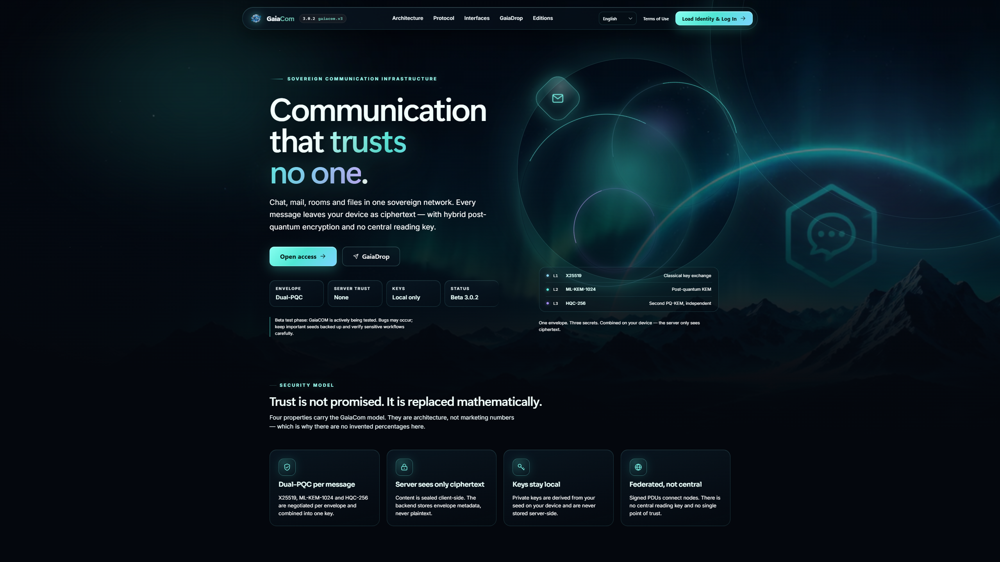
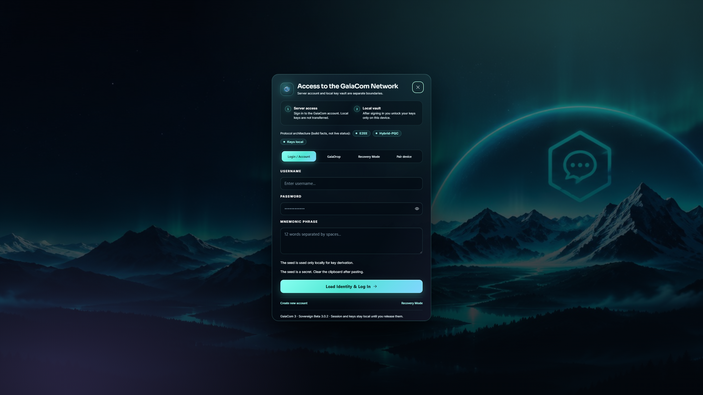
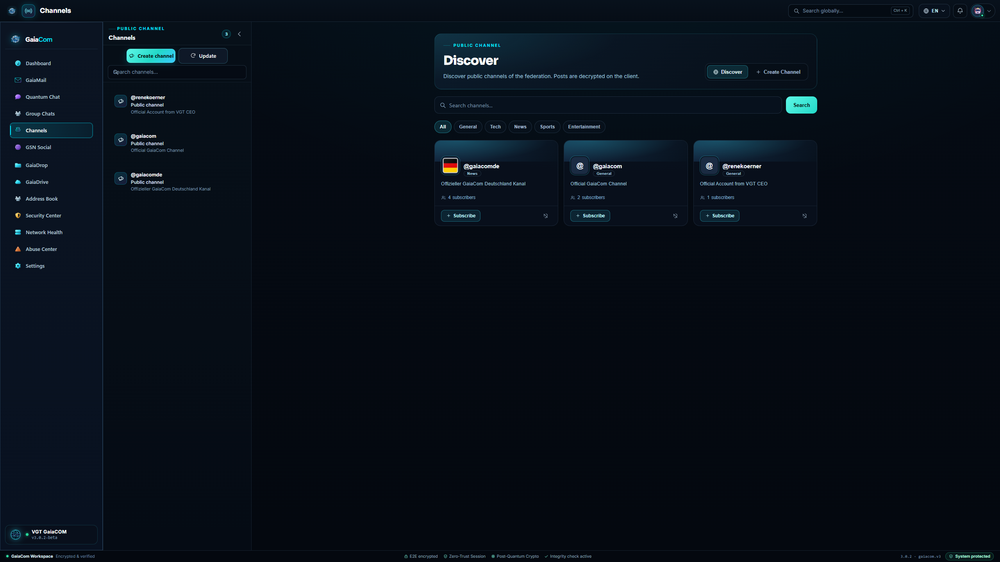
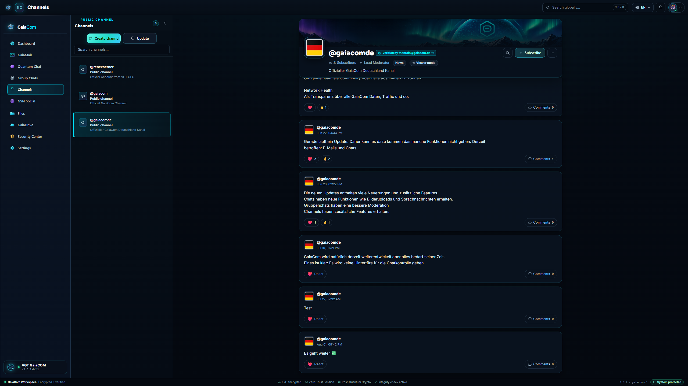

[English](README.md) · [Deutsch](README.de.md) · **Русский** · [Español](README.es.md) · [Français](README.fr.md) · [فارسی](README.fa.md) · [日本語](README.ja.md) · [Português](README.pt.md) · [العربية](README.ar.md) · [简体中文](README.zh.md) · [हिन्दी](README.hi.md) · [Türkçe](README.tr.md) · [Italiano](README.it.md) · [Polski](README.pl.md) · [Українська](README.uk.md) · [한국어](README.ko.md) · [Indonesia](README.id.md) · [Shqip](README.sq.md)

<div align="center">


# GaiaCom

### Суверенная постквантовая инфраструктура связи

[](CHANGELOG.md)
[](LICENSE)
[](#technical-information)
[](#technical-information)
[](SOVEREIGN_CRYPTO.md)
[](#beta-v3)
[](#security-and-audit-status)
[](https://gaiacom.de)

**Федеративная платформа связи с шифрованием на стороне клиента и гибридным постквантовым дизайном.**

</div>

> **VisionGaiaTechnology — Департамент ненужной безопасности™**
>
> Мы создаём инфраструктуру связи, которая не требует доверия, которое не может доказать.
> Департамент существует потому, что «ненужная» безопасность — это ровно то, что становится
> необходимым в тот момент, когда ключи держит кто-то другой.

---

## Меню

[Обзор](#overview) · [VGT Licence](#vgt-licence) · [Beta V3](#beta-v3) · [Скриншоты](#screenshots) · [Возможности](#features) · [Техническая информация](#technical-information) · [Чем GaiaCom отличается](#what-makes-gaiacom-different) · [Сборка из исходного кода](#build-from-source) · [Стать оператором узла](#become-a-node-operator) · [Статус безопасности и аудита](#security-and-audit-status) · [Структура проекта](#project-structure) · [Участие в разработке](#contributing) · [Лицензия](#license)

---

<a id="overview"></a>
## Обзор

Сегодняшние коммуникационные стеки не были спроектированы для постквантового мира. Мессенджеры
централизуют доверие у одного провайдера, классическая электронная почта изначально не была
конфиденциальной по своему замыслу, а большинство платформ хранят читаемую копию всего, что они
передают.

**GaiaCom переопределяет защищённую связь как суверенную инфраструктуру.**

Он объединяет федеративную сеть, сквозное шифрование на стороне клиента, версионируемый гибридный
постквантовый конверт, зашифрованные социальные каналы, зашифрованное файловое хранилище и слой
управления для операторов узлов — в одной идентичности, в вебе, на десктопе и на мобильных
устройствах.

Базовое правило намеренно мало:

```text
Сервер может маршрутизировать, хранить, ограничивать частоту запросов, вести аудит и применять политики.
Сервер никогда не должен получать возможность расшифровывать нативное приватное содержимое.
```

GaiaCom — это **не** заявление об абсолютной безопасности. Это попытка сделать границы доверия
явными, проверяемыми и — где возможно — математически принудительными.

---

<a id="vgt-licence"></a>
## VGT Licence

GaiaCom доступен в 3 редакциях:

**Один протокол. Три модели работы.**

### Business — GaiaCom Enterprise

Для корпораций, юридических фирм, бизнеса и приватного банкинга. Закрытые коммуникации с административным контролем.

- Внутренний суверенитет и управление пользователями
- Собственный сервер (self-hosted) или управляемый суверенный кластер
- Соглашение SLA, техподдержка и премиум-модули

### Public — GaiaCom Network

Открытая сеть для цифровой приватности. Без продажи данных, инфраструктура для свободной защищенной связи.

- Клиентское приложение с открытым исходным кодом
- Федеративные узлы (ноды)
- Отсутствие центрального ключа расшифровки

### Government — GaiaCom Defend

Специализированная инфраструктура для государственных органов и изолированных сегментов связи.

- Развертывание в изолированных физических сетях (air-gapped)
- Возможность брендирования и аудит исходного кода
- Национальный цифровой суверенитет кластера

> **Текущая тестовая версия и коммерческое лицензирование (двойное лицензирование)**
>
> Версия, которая сейчас тестируется в этом репозитории, — это публичная редакция **GaiaCom Network** (Beta V3) под открытой лицензией **AGPL-3.0-or-later** (см. [LICENSE](LICENSE)). Любое сетевое развёртывание или модификация `GaiaCom Network` по открытой лицензии строго подчиняются требованиям копилефта AGPL и обязательству по раскрытию исходного кода для операторов сети (и не предоставляют прав на товарные знаки, SLA или модули Enterprise/Defend).
>
> **Для компаний и государственных органов система не является бесплатной.** Тем, кто планирует использовать GaiaCom в компаниях (**GaiaCom Enterprise**) или в государственных органах и критической инфраструктуре (**GaiaCom Defend**) — включая закрытые или продуктивные развёртывания без обязательств по раскрытию исходного кода по AGPL, модули Enterprise/Defend, управляемые суверенные кластеры, брендирование (white labeling), аудит исходного кода или SLA и поддержку, — требуется коммерческая **VGT Licence**. Пожалуйста, обратитесь в VisionGaiaTechnology через зашифрованную форму запроса:
> **[https://visiongaiatechnology.de/#vgt-comlink](https://visiongaiatechnology.de/#vgt-comlink)**

---

<a id="beta-v3"></a>
## Beta V3

> **GaiaCom 3 — публичная техническая бета. Относитесь к ней соответственно.**

- **Статус:** Beta V3, версия `3.0.2`.
- **Независимый криптографический аудит не завершён.** Постквантовый дизайн, реализации
  протоколов и криптографические границы **не** проверялись независимой сторонней
  криптографической лабораторией.
- Мы провели **глубокие аудиты безопасности с поддержкой ИИ** по архитектуре, аутентификации,
  авторизации, федерации, хранению, границам браузера и десктопа. Эти аудиты нашли и исправили
  реальные проблемы. Они **не являются доказательством безопасности**.
- **Неизвестные уязвимости всё ещё могут существовать** — в дизайне протокола, в реализации, в
  зависимостях, в операционной среде или на самом устройстве пользователя.
- Криптографию легко сделать тонко неправильной. Ошибочные допущения не всегда видны в тестах. Не
  считайте названия алгоритмов гарантией безопасности.
- **Не используйте GaiaCom в этой бете для критичной для жизни, законодательно регулируемой,
  особо ценной или необратимой связи.** Храните независимые резервные копии важных seed и данных.
- Между бета-релизами возможны ломающие изменения протокола и API. Возможна потеря данных.
- Веб-клиент может быть подменён скомпрометированным узлом до того, как произойдёт шифрование.
  Поэтому профиль высокой гарантии требует доверенных, независимо собранных нативных клиентов.
- SMTP-мост — это намеренная граница понижения. Сообщения, покидающие нативное защищённое
  пространство GaiaCom, защищены лишь настолько, насколько это позволяет legacy-путь.

Если вы обнаружили проблему безопасности, сообщите о ней приватно — см.
[SECURITY.md](SECURITY.md). Пожалуйста, не публикуйте детали активных эксплойтов.

---

<a id="screenshots"></a>
## Скриншоты

Все скриншоты сделаны в GaiaCom 3.0.2 при разрешении 2560 × 1440. Показанный интерфейс — текущий
дизайн VGT Aurora; скриншоты содержат только публичные поверхности продукта и публичный
федеративный контент.

| Стартовая страница | Идентичность и доступ |
|---|---|
|  |  |
| **Публичные каналы — обнаружение** | **Публичные каналы — просмотр канала** |
|  |  |

---

<a id="features"></a>
## Возможности

### Идентичность и доступ

- **Самостоятельно управляемая идентичность Gaia ID** — `@name:node.example.org`, производная от
  локально сгенерированного seed. Приватные ключи остаются на устройстве.
- **Локальное хранилище ключей** с явной разблокировкой, блокировкой сеанса и настраиваемой
  автоблокировкой.
- **Сопряжение нескольких устройств** через QR-потоки или одноразовые потоки сопряжения, а также
  список устройств и их отзыв.
- **История ключей и предупреждения об изменениях**, когда меняется ключ идентичности контакта.
- **Потоки восстановления** с явным, записанным вручную recovery-seed; серверного бэкдора для
  восстановления не существует.
- **18 языков интерфейса** с живым переключателем языка (стартовая страница, аутентификация,
  рабочее пространство).

### Обмен сообщениями

- **Quantum Chat** — беседы 1:1 с шифрованием на стороне клиента, ответами, реакциями,
  закреплениями, поиском, вложениями, голосовыми заметками и зашифрованными превью изображений.
- **Групповые чаты** — комнаты с каналами, ролями, модерацией, управлением участниками, slow mode,
  каналами только для чтения, заявками на вступление, приглашениями, событиями аудита и
  зашифрованным экспортом.
- **Реакции** — управление реакциями с приоритетом сердца: наведение курсора на десктопе или
  долгое нажатие на сенсорном экране открывает полную палитру; ровно одна реакция отображается как
  ваша собственная.
- **Никаких фальшивых состояний** — значения сообщений, реакций, присутствия и активности берутся
  из реального бэкенда или показываются как недоступные. GaiaCom не выдумывает счётчики.

### GaiaMail

- Почта в рамках той же криптографической идентичности, что и чат.
- Нативный GaiaMail между идентичностями GaiaCom.
- **SMTP-мост** для legacy-контактов — явно отделён от нативного E2EE и защищён только в той мере,
  в какой это позволяет legacy-путь.
- Подписи, папки, фильтры и метки обрабатываются локально.

### GSN Social

Социальный слой GaiaCom — не отдельная платформа с отдельной учётной записью. Он повторно
использует вашу суверенную идентичность:

- **Домашняя лента**, **Обзор**, **Моя сеть**, **Сообщения**, **Уведомления**, **Группы**,
  **Каналы** и **GSN Cloud** (интеграция с GaiaDrive).
- Публикации, зашифрованные изображения, комментарии, реакции, репосты и тренды хэштегов,
  вычисляемые по реальным публикациям.
- Подписчики, подписки и рекомендуемые контакты, выведенные из фактических федеративных
  взаимодействий.
- **Публичные каналы** для широковещательной связи с подписками, обнаружением, категориями, медиа,
  комментариями и модерацией.

### Файлы, хранилище и центр безопасности

- **GaiaDrive** — зашифрованное файловое хранилище и общий доступ, привязанные к той же
  идентичности.
- **GaiaDrop** — приём зашифрованных файлов от внешних отправителей без учётной записи.
- **GaiaVault** — локальное запечатанное хранилище для секретов и ключей.
- **Центр безопасности** — реальное состояние устройств, сеансов, ключей и событий безопасности, а
  также процессы управления и обработки злоупотреблений.

### Управление и эксплуатация

- Роли оператора узла, старшего ревьюера и доверенного ревьюера.
- Fail-closed бутстрап управления: новый узел по умолчанию **не** выдаёт роль оператора.
- Жалобы на злоупотребления, модерация, поверхности прозрачности и append-only события аудита.
- Федерация через подписанные PDU «сервер—сервер» с защитой от повторного воспроизведения и
  ограничениями SSRF.

### Десктоп и мобильные устройства

- **Веб/PWA**-клиент с усиленной CSP и без кода, доставляемого через CDN.
- **Десктопный клиент Tauri 2** для Windows, Linux и macOS с нативными элементами управления окном
  и без нативных разрешений команд сверх явного списка разрешений.
- **Android**-архитектура узла/клиента с нативным криптоядром и платформенными привязками.

---

<a id="technical-information"></a>
## Техническая информация

### Стек

| Уровень | Технология |
|---|---|
| Веб-клиент | React 18, Vite 8, слои дизайна на чистом CSS |
| Десктоп | Tauri 2 (Rust + WebView2/WebKit), собственное безрамочное окно |
| Бэкенд | Go 1.25 (`toolchain go1.26.5`), стандартная библиотека + SQLite, службы федерации и управления |
| База данных | SQLite в режиме WAL (бета-профиль с одним писателем), версионируемые миграции |
| Криптоядро | Rust (`gaiacore`), провайдер WebAssembly для HQC в браузере, нативный провайдер Tauri |
| Мобильные | Android-приложение + Go mobile bindings / архитектура node kernel |
| Локализация | 18 языков, общие таблицы переводов |

### Криптографический дизайн (Sovereign v1)

```text
Key establishment:  X25519  +  ML-KEM-1024  +  HQC-256
Combiner:           length-prefixed secrets → HKDF-SHA3-512
Accelerated AEAD:   Twofish-256-EAX → AES-256-GCM
Top Secret AEAD:    Serpent-256-CTR + HMAC-SHA3-512 → Twofish-256-EAX
                    → XChaCha20-Poly1305 → AES-256-GCM-SIV
Signatures:         Ed25519 transcript signature
Top Secret sigs:    Ed25519 + ML-DSA-87
```

Подписанный транскрипт связывает версию протокола, точный набор алгоритмов, идентичности
отправителя и получателя, ключ шифрования получателя, эфемерный ключ, оба KEM-шифртекста,
идентификатор сообщения, метку времени, nonce и зашифрованную полезную нагрузку. Неизвестные
наборы, отсутствующие доказательства keyset, отсутствующие подписи Top Secret и некорректные
HQC-шифртексты отклоняются fail-closed.

**Важная граница:** Sovereign v1 — это гибридный конверт на каждое сообщение, **а не Triple
Ratchet**. Он не заявляет посткомпрометационную безопасность, производную от ratchet. Точная
граница задокументирована в [SOVEREIGN_CRYPTO.md](SOVEREIGN_CRYPTO.md).

### Сетевая модель

- Федеративные узлы, без обязательного центрального сервера.
- Подписанные PDU «сервер—сервер» для федерации.
- Сервер хранит маршрутизирующие конверты, зашифрованные полезные нагрузки/чанки, публичные поля
  профиля и минимальные метаданные — никогда нативный открытый текст.
- Локальное или S3/MinIO-совместимое зашифрованное объектное хранилище.
- TLS обязателен вне локальной разработки.

### Требования

| Инструмент | Версия |
|---|---|
| Node.js | 24.13 (минимум 20.19) |
| npm | установка на основе lockfile (`npm ci`) |
| Go | toolchain 1.26.5 (модуль нацелен на 1.25) |
| Rust | stable (закреплён CI для ядра) |
| Tauri CLI | 2.x для упаковки десктопа |
| Python | 3.10+ (необязательные скрипты репозитория и безопасности) |

---

<a id="what-makes-gaiacom-different"></a>
## Чем GaiaCom отличается

Большинство «защищённых» мессенджеров улучшают один слой. GaiaCom пытается сделать весь стек
согласованным:

- **Суверенная идентичность вместо платформенных учётных записей.** Ваша идентичность — это
  криптографическая идентичность, а не строка в чужой таблице пользователей. Узлы федераруются;
  они не владеют вами.
- **Двойное постквантовое установление ключа на каждое сообщение.** Один классический и два
  независимых постквантовых KEM объединяются, с отклонением понижения, когда выбран профиль
  Sovereign.
- **Шифрование до транспорта, по построению.** Клиент запечатывает содержимое до того, как оно
  попадёт в сеть; сервер маршрутизирует шифртекст и не может его прочитать.
- **Социальное, почта, файлы и чат в одной идентичности.** Никакой второй учётной записи, никакой
  второй модели доверия, никакой отдельной платформы, которая сольёт ваш граф.
- **Федеративность по дизайну.** Никакого обязательного центрального почтового ящика, никакой
  единой точки доверия, никакого глобального ключа чтения.
- **Честные состояния интерфейса.** Отсутствующие данные показываются как отсутствующие, а не
  заменяются декоративными числами или выдуманной активностью.
- **Явные границы понижения.** SMTP, legacy-конверты и доставка через браузер задокументированы
  как границы, а не спрятаны за маркетинговым языком.
- **Открытый исходный код, AGPL-3.0-or-later.** Сетевое программное обеспечение остаётся
  проверяемым, а вклады — доступными сообществу.
- **Создано для операторов.** Fail-closed управление, события аудита, процессы обработки
  злоупотреблений и задокументированный путь оператора узла.

---

<a id="build-from-source"></a>
## Сборка из исходного кода

### 1. Предварительные требования

Установите Node.js 24.13+, Go 1.26.5+, Rust stable и — для сборок десктопа —
[предварительные требования Tauri 2](https://tauri.app/start/prerequisites/) для вашей
операционной системы.

```bash
git clone <YOUR-REPOSITORY-URL> GaiaCom
cd GaiaCom
```

### 2. Веб-клиент

```bash
cd Frontend/frontend
npm ci
npm test
npm run build
```

Продакшен-бандл записывается в `Frontend/frontend/dist/`.

Для локальной разработки:

```bash
npm start
# http://127.0.0.1:5173
```

Устанавливайте `VITE_API_URL` только на origin работающего бэкенда GaiaCom, например:

```bash
VITE_API_URL=http://127.0.0.1:8080 npm start
```

### 3. Бэкенд

```bash
cd Backend
go build -trimpath \
  -ldflags="-s -w \
    -X gaiacom/backend/buildinfo.Version=3.0.2 \
    -X gaiacom/backend/buildinfo.Commit=$(git rev-parse --short HEAD) \
    -X gaiacom/backend/buildinfo.BuiltAt=$(date -u +%Y-%m-%dT%H:%M:%SZ)" \
  -o gaiacom-backend ./cmd/gaiacom
```

Запустите локальный узел разработки:

```bash
cp .env.example .env
# generate independent secrets for development only
export $(grep -v '^#' .env | xargs)
./gaiacom-backend
```

API слушает на `SERVER_PORT` (по умолчанию `8080`). База данных SQLite создаётся по пути `DB_PATH`.
Никогда не используйте шаблонные секреты в продакшене.

### 4. Десктопный клиент (Tauri 2)

Сначала соберите веб-клиент, затем:

```bash
cargo install tauri-cli --version "^2"
cd DesktopClient/src-tauri
cargo tauri build
```

Установщики и исполняемые файлы записываются в `DesktopClient/src-tauri/target/release/bundle/`.
Для быстрой неподписанной сборки без установщиков:

```bash
cargo tauri build --no-bundle
```

### 5. Криптографическое ядро на Rust

```bash
cd Core/rust/gaiacore
cargo test --locked
cargo clippy --locked --all-targets -- -D warnings
```

### 6. Android (необязательно)

Сборки для Android требуют JDK 17, Android SDK/NDK и закреплённого toolchain. См. `Android/` и
`docs/` для текущего профиля сборки. Android-клиент — часть бета-дерева исходников, а не готовый
релиз в магазине.

---

<a id="become-a-node-operator"></a>
## Стать оператором узла

Узел GaiaCom — это федеративный бэкенд, который обслуживает идентичности, сообщения, каналы,
социальные поверхности и хранилище для своих пользователей. Он может работать на обычном
Linux-сервере.

### Рекомендуемая база

- Linux x86_64 или arm64, 64-бит
- 2+ vCPU, 4 ГБ RAM, 20+ ГБ SSD для узла оценки (рассчитывайте под реальную нагрузку)
- Выделенное DNS-имя, например `node.example.org`
- Действительный TLS-сертификат (Let's Encrypt подходит)
- SMTP-релей **только если** вы намеренно включаете legacy-мост
- Резервные копии, которые вы действительно проверяете

### 1. Сборка и установка

```bash
cd Backend
go build -trimpath \
  -ldflags="-s -w \
    -X gaiacom/backend/buildinfo.Version=3.0.2 \
    -X gaiacom/backend/buildinfo.Commit=$(git rev-parse --short HEAD) \
    -X gaiacom/backend/buildinfo.BuiltAt=$(date -u +%Y-%m-%dT%H:%M:%SZ)" \
  -o gaiacom-backend ./cmd/gaiacom

sudo install -d -o gaiacom -g gaiacom /opt/gaiacom /var/lib/gaiacom /etc/gaiacom
sudo install -o gaiacom -g gaiacom -m 0755 gaiacom-backend /opt/gaiacom/gaiacom-backend
```

Релизные бинарники отказываются запускаться без неизменяемых метаданных сборки; не удаляйте эти
значения `-X`.

### 2. Инициализация узла

```bash
sudo /opt/gaiacom/gaiacom-backend setup \
  --server-name node.example.org \
  --config /etc/gaiacom/gaiacom.env \
  --db-path /var/lib/gaiacom/gaiacom.db \
  --port 8080

sudo /opt/gaiacom/gaiacom-backend doctor --config /etc/gaiacom/gaiacom.env
```

`setup` генерирует независимые продакшен-секреты, идентичность подписи узла и файл конфигурации.
Держите `/etc/gaiacom/gaiacom.env` в режиме `0600`, принадлежащим служебному пользователю.

Ключевые настройки:

| Переменная | Назначение |
|---|---|
| `GAIACOM_SERVER_NAME` | Канонический FQDN этого узла; используется в Gaia ID и федерации |
| `GAIACOM_DEV_MODE=false` | Продакшен-режим, строгое поведение SSRF и CSP |
| `GAIACOM_JWT_SECRET`, `GAIACOM_SHIELD_SECRET`, `GAIACOM_METRICS_TOKEN` | Независимые секреты 32+ байта |
| `GAIACOM_SERVER_PRIVATE_KEY` | Стабильный ключ подписи узла Ed25519 — никогда не ротировать неявно |
| `GAIACOM_TRUSTMESH_EPOCH_SECRET` | Стабильный секрет вывода эпохи TrustMesh |
| `DB_PATH` | Путь к постоянной базе данных SQLite |
| `GAIACOM_STORAGE_ROOT` | Зашифрованное хранилище вложений вне веб-корня |
| `GAIACOM_TRUSTED_PROXY_CIDRS` | Только если обратный прокси передаёт IP клиентов |

### 3. Бутстрап управления (обязателен, fail-closed)

Новый узел намеренно не выдаёт **никакой** роли оператора. Создайте первую идентичность через
клиент, затем авторизуйте именно этот полностью квалифицированный Gaia ID как оператора узла:

```bash
sudo install -o root -g gaiacom -m 0600 /dev/null /etc/gaiacom/governance.json
```

```json
{
  "bootstrap_gaia_id": "@operator:node.example.org",
  "operators": [
    { "gaiaID": "@operator:node.example.org" },
    { "gaiaID": "@backup-operator:node.example.org" }
  ]
}
```

Укажите на него бэкенду и перезапустите:

```bash
echo 'GAIACOM_GOVERNANCE_CONFIG=/etc/gaiacom/governance.json' \
  | sudo tee -a /etc/gaiacom/gaiacom.env
```

Используйте только полностью квалифицированные Gaia ID (`@name:node.example.org`). Администратора
по умолчанию и god-mode fallback не существует.

### 4. Юнит systemd

```ini
[Unit]
Description=GaiaCom Node
After=network-online.target
Wants=network-online.target

[Service]
Type=simple
User=gaiacom
Group=gaiacom
WorkingDirectory=/var/lib/gaiacom
EnvironmentFile=/etc/gaiacom/gaiacom.env
ExecStart=/opt/gaiacom/gaiacom-backend
Restart=on-failure
RestartSec=5
NoNewPrivileges=true
PrivateTmp=true
PrivateDevices=true
ProtectSystem=strict
ProtectHome=true
ProtectKernelTunables=true
ProtectKernelModules=true
ProtectControlGroups=true
ProtectClock=true
ProtectHostname=true
ProtectProc=invisible
ProcSubset=pid
RestrictSUIDSGID=true
RestrictRealtime=true
LockPersonality=true
MemoryDenyWriteExecute=true
SystemCallArchitectures=native
CapabilityBoundingSet=
AmbientCapabilities=
RestrictAddressFamilies=AF_UNIX AF_INET AF_INET6
StateDirectory=gaiacom
StateDirectoryMode=0700
ConfigurationDirectory=gaiacom
ConfigurationDirectoryMode=0700
ReadWritePaths=/var/lib/gaiacom /opt/gaiacom/storage
UMask=0077
LimitNOFILE=65536

[Install]
WantedBy=multi-user.target
```

```bash
sudo systemctl daemon-reload
sudo systemctl enable --now gaiacom
sudo systemctl status gaiacom
```

### 5. TLS-обратный прокси и веб-клиент

Отдавайте собранный `Frontend/frontend/dist/` через TLS-обратный прокси и проксируйте API на
бэкенд по `127.0.0.1:8080`. Минимальные требования:

- TLS 1.2+ (предпочтителен TLS 1.3), HSTS
- `X-Content-Type-Options: nosniff`, `X-Frame-Options: DENY`
- Строгая Content-Security-Policy
- Без листинга каталогов, без source maps в продакшене
- Только обратные прокси, перечисленные в `GAIACOM_TRUSTED_PROXY_CIDRS`, могут передавать
  forwarded IP клиентов

Пример конфигурации намеренно **не** поставляется с реальными именами хостов или сертификатами;
используйте свой домен и свои пути к сертификатам.

### 6. Федерация и эксплуатация

- Объявите и опубликуйте свой канонический `GAIACOM_SERVER_NAME`; партнёры обращаются к вам по
  HTTPS.
- Федерация использует подписанные PDU «сервер—сервер» с защитой от повторов и защитой от SSRF.
- Следите за службой, использованием диска, целостностью резервных копий и сроком действия
  сертификатов.
- Регулярно тестируйте восстановление базы данных SQLite и объектного хранилища.
- Держите ключ подписи узла стабильным между обновлениями; его ротация разрушает доверие
  федерации.
- Не запускайте несколько процессов бэкенда против одного файла SQLite. Горизонтальное
  масштабирование базы данных (Postgres, реплики active/active) не входит в этот бета-профиль.

### Предупреждения для операторов узла

- Бета-программное обеспечение; без заявлений о HA; требуются окна обслуживания и перезапуски.
- Governed content и процессы обработки злоупотреблений в этой бете определяются политикой каждого
  узла.
- Автоматические обновления десктопа отключены до появления подписанного обновлятора.
- SMTP-релей требует аутентифицированного TLS плюс SPF, DKIM и применяемой политики DMARC.
  Сообщения, покидающие нативный GaiaCom, не покрываются гарантиями нативного E2EE.
- Вы отвечаете за резервные копии, секреты, TLS, DNS, обработку злоупотреблений и местное
  законодательство.

---

<a id="security-and-audit-status"></a>
## Статус безопасности и аудита

### Что было сделано

- Глубокие аудиты безопасности с поддержкой ИИ по бэкенду, фронтенду, федерации, хранению,
  аутентификации, авторизации, границам десктопа и браузера.
- Статические security-gates, состязательные наборы тестов, проверки зависимостей и гигиены
  секретов.
- Явные инварианты безопасности: никакого серверного открытого текста, никакого экспорта приватных
  ключей, никакой конечной точки имперсонации, никакого обхода E2EE, никакого глобального ключа
  чтения.
- Fail-closed значения по умолчанию для управления, валидации секретов и согласования протокола.
- Реальная живая проверка поверхностей продукта и UI-потоков во время разработки.

### Что **не** было сделано

- **Никакого независимого криптографического аудита третьей стороной.**
- Никакой формальной верификации протокола или реализаций.
- Никакой гарантии, что неизвестных уязвимостей не существует.
- Никакой сертификации государственного уровня или высокой гарантии.
- Поведение во время выполнения зависит от узла, браузера, операционной системы и безопасности
  собственного устройства пользователя.

### Сообщение об уязвимостях

Пожалуйста, сообщайте об уязвимостях приватно:

- Эл. почта: **security@gaiacom.de**
- Не открывайте публичный issue для активной уязвимости.
- Укажите затронутый компонент, версию/коммит, шаги воспроизведения и ожидаемое/наблюдаемое
  поведение.
- Пожалуйста, не тестируйте чужие узлы или данные и не проводите разрушительные атаки.

См. [SECURITY.md](SECURITY.md) для полной политики и
[docs/BETA_LIMITATIONS.md](docs/BETA_LIMITATIONS.md) для текущих границ беты.

### Использование с высокой гарантией

Если вам нужна система, которая защищает жизнь, свободу или регулируемые данные, эта бета **пока
не** является такой системой. По-прежнему требуются независимые аудиты, воспроизводимые сборки,
подписанные релизы, проверенные цепочки обновлений, оперативное управление ключами и реагирование
на инциденты.

---

<a id="project-structure"></a>
## Структура проекта

```text
GaiaCom/
├── Backend/                  Go API, федерация, управление, хранение, безопасность
├── Frontend/frontend/        React веб-клиент и PWA
├── DesktopClient/src-tauri/  Десктопная оболочка Tauri 2
├── Android/                  Архитектура узла/клиента Android
├── Core/rust/gaiacore/       Криптографическое ядро на Rust
├── SovereignCryptoCore/      Криптографическая библиотека на Rust
├── SovereignCryptoWasm/      Провайдер WASM-криптографии для браузера
├── docs/                     Архитектура, эксплуатация узла, границы беты, скриншоты
├── assets/brand/             Логотип GaiaCom и брендовые ресурсы
├── SECURITY.md               Политика безопасности и раскрытие уязвимостей
├── SOVEREIGN_CRYPTO.md       Криптографический дизайн и границы
└── LICENSE                   AGPL-3.0-or-later
```

---

<a id="contributing"></a>
## Участие в разработке

Вклады приветствуются, если они сохраняют инварианты безопасности и честность заявлений.

- Сначала прочитайте [CONTRIBUTING.md](CONTRIBUTING.md).
- Соблюдайте zero-trust границу: никакого серверного открытого текста, никакого экспорта приватных
  ключей, никакого обхода E2EE.
- Добавляйте тесты для поведения, значимого для безопасности.
- Никогда не коммитьте секреты, реальные пользовательские данные, приватные ключи, базы данных или
  артефакты сборки.
- Не ослабляйте security-gates, чтобы сборка прошла.
- Сообщайте об уязвимостях приватно, а не в pull request.

Участвуя, вы соглашаетесь с [Code of Conduct](CODE_OF_CONDUCT.md).

---

<a id="license"></a>
## Лицензия

GaiaCom использует модель **двойного лицензирования** (см. [VGT Licence](#vgt-licence)):
публичная кодовая база с открытым исходным кодом (`GaiaCom Network`) распространяется под
лицензией **GNU Affero General Public License v3.0 or later** (AGPL-3.0-or-later) — см.
[LICENSE](LICENSE). Для корпоративного использования (**GaiaCom Enterprise**),
государственных органов (**GaiaCom Defend**) и закрытых или коммерческих развёртываний без
обязательств по раскрытию кода AGPL (включая премиум-модули, SLA/поддержку, white labeling
и изолированные контуры air-gapped) система **не является бесплатной** и требует
приобретения коммерческой **VGT Licence** через
[https://visiongaiatechnology.de/#vgt-comlink](https://visiongaiatechnology.de/#vgt-comlink).

Операторы сети, запускающие модифицированное открытое ПО GaiaCom по условиям AGPL, обязаны
сделать соответствующий исходный код доступным, как того требует AGPL. Компоненты третьих
сторон и их лицензии перечислены в [THIRD_PARTY_NOTICES.md](THIRD_PARTY_NOTICES.md) и в
соответствующих манифестах пакетов.

GaiaCom и логотип GaiaCom являются товарными знаками VisionGaiaTechnology. Лицензия AGPL
не предоставляет прав на товарные знаки.

---

<div align="center">

**VisionGaiaTechnology — Департамент ненужной безопасности™**

*Суверенная связь, создаваемая открыто.*

[Веб-сайт](https://gaiacom.de) · [Безопасность](SECURITY.md) · [Архитектура](docs/ARCHITECTURE.md)

</div>
